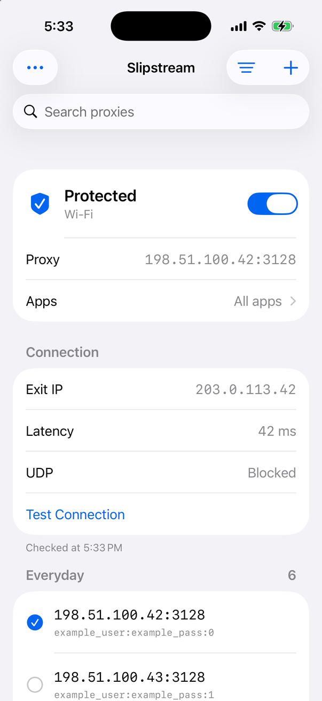
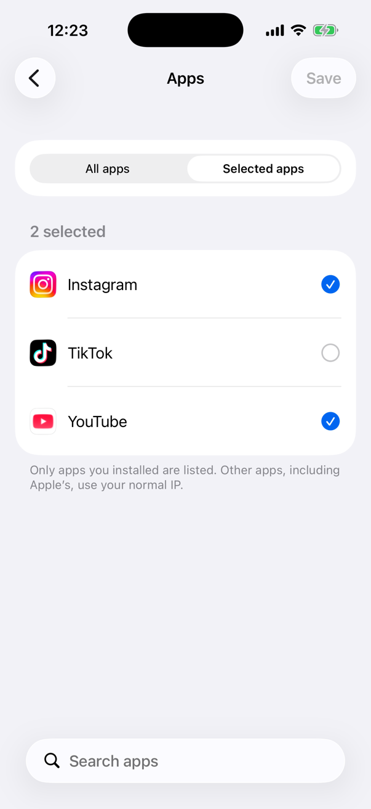
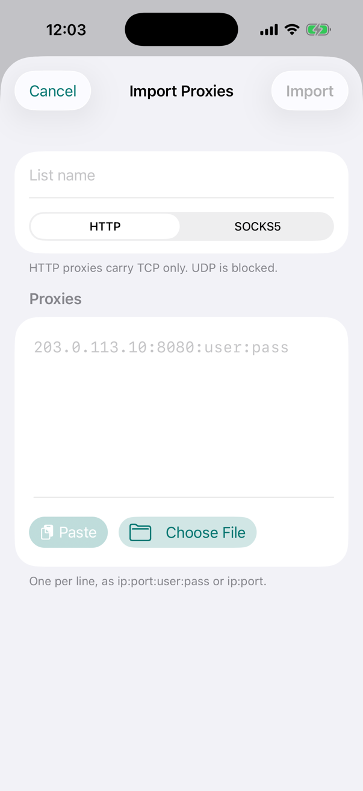

<div align="center">


# Slipstream

*Send a jailbroken iPhone's app traffic through your HTTP or SOCKS5 proxy.*

[](#install)
[](#install)
[](https://10.github.io/slipstream-ios/)
[](LICENSE)

</div>

---

https://github.com/user-attachments/assets/fe4b98c0-dd05-452f-87f3-2f2fb45c1ead

<p align="center">
  
  
  
</p>

Import a proxy list, pick a proxy, and choose which apps use it. Slipstream is a
Home Screen app over a native iOS app proxy, so iOS hands it each protected
app's connections and no tunnel interface appears for an app's VPN check to
find. HTTPS stays end-to-end encrypted. Screenshots use preview data.

## Features

- **Per-app or all apps** — protect only the apps you pick, or every app you installed. Everything else keeps its normal connection.
- **HTTP CONNECT and SOCKS5** — with or without credentials. SOCKS5 proxies can also relay UDP.
- **No `utun` interface** — an `NEAppProxyProvider`, not a packet tunnel, so nothing new shows up in an app's interface list or proxy settings.
- **Proxy lists** — paste or import `ip:port:user:pass` lists, search them, and switch proxies in place without dropping protection.
- **Connection check** — handshake latency, the exit IP, and whether UDP is relayed.
- **Fails closed** — when the proxy is down, protected apps fail instead of going direct.

## Install

In Sileo, go to **Sources → +** and add:

```
https://10.github.io/slipstream-ios/
```

Or open [that page](https://10.github.io/slipstream-ios/) on the phone and tap
**Add to Sileo**. Then install **Slipstream**. Sileo picks the rootless build
(Dopamine, palera1n) or the rootful one (Taurine) for your device.

Requires iOS 14 or later and an active jailbreak. The package depends on
`uikittools` 2.1.2 or later, which Sileo installs with it. Updates arrive through
the same source.

To remove it, use **Sileo → Packages → Slipstream → Uninstall**. Removal restores
normal networking and keeps your saved lists for a reinstall;
`apt-get purge io.github.10.slipstream` as root erases them too.

## Usage

1. Open **Slipstream** and tap **+** to import. Paste a list or choose a UTF-8 `.txt` file, name the list, and pick **HTTP** or **SOCKS5**.
2. Tap a proxy to select it and turn protection on.
3. Open **Apps** to choose **All apps** or **Selected apps**, then save.
4. Tap **Test Connection** to check latency, the exit IP, and UDP.

Switching proxies keeps protection on during the change. Closing the app leaves
protection running. Swipe a proxy to remove it; **••• → Manage Lists** renames
and deletes lists.

## Proxy lists

One proxy per line, as `ip:port:user:pass` or `ip:port` without authentication:

```
203.0.113.10:8080:user:pass
203.0.113.11:8080
```

Endpoints must be numeric IPv4 addresses. Passwords may contain colons. The same
endpoint can be saved once per protocol, and importing into an existing list
skips duplicates. Limits: 5,000 saved proxies and 1 MB per import.

## What gets routed

| Traffic | HTTP proxy | SOCKS5 proxy |
| --- | --- | --- |
| TCP, IPv4 and IPv6 | CONNECT | CONNECT |
| DNS | TCP through the proxy | TCP through the proxy |
| Other UDP, including QUIC | Refused | UDP ASSOCIATE, or blocked if the proxy refuses |

Connections by hostname reach the proxy as names. **All apps** means every app
you installed, not the whole device: Apple's apps (Safari, Mail), system
daemons, and apps that need domain-based rules keep their normal connection. An
app installed later is covered from the next restart or proxy change. Protected
apps reach LAN addresses only through the proxy; SSH to the phone is never
routed.

The Apps screen lists only apps you installed, and labels the ones iOS can't
protect with per-app rules.

## Command line

The app covers everything, but the same controls work over SSH as root:

```bash
slipstreamctl status     # protected, starting, unavailable, or disabled
slipstreamctl check      # proxy latency and UDP, as Test Connection reports them
slipstreamctl enable
slipstreamctl restart
slipstreamctl disable
```

`protected` means the native session is connected, not that the proxy is
healthy. That's what **Test Connection** checks. The binaries live in
`/var/jb/usr/local/bin` on rootless jailbreaks and `/usr/local/bin` on rootful
ones.

## Security

- Saved proxies and credentials are root-only files under `etc/slipstream` in the jailbreak prefix. The app shows credentials beneath each address, so keep screenshots private.
- The app reaches them through a fixed-purpose setuid helper that serves only the installed Slipstream app. There's no HTTP server, management port, or credentials in command arguments.
- Protection depends on the jailbreak. After a reboot, re-jailbreak and check the status before relying on it.
- Routing isn't invisible. An app can still detect flow diversion, for example through URLSession metrics.
- It's not a boundary against another root process on the phone.

## Limitations

- Proxy endpoints must be numeric IPv4.
- Apple's apps can't be protected; iOS only matches them with domain rules.
- HTTP proxies carry TCP only.
- Live-tested on iPhone XS (iOS 18.5, Dopamine), iPhone 11 (iOS 14.8.1, Taurine), and iPhone 7 (iOS 15.8.3, Dopamine).

## Layout

```
slipstream-ios/
├── app/                      # SwiftUI app, setuid helper, icon pipeline
├── provider/                 # NEAppProxyProvider extension
├── src/                      # Rust relay engine, management API, iOS configuration
├── patches/                  # iOS patches for the pinned tun2proxy
├── scripts/                  # build, package, slipstreamctl
├── packaging/                # maintainer scripts, entitlements, signing key
├── tests/                    # host tests, package check, on-device audits
└── docs/                     # architecture, validation records, research
```

The relay reuses [tun2proxy](https://github.com/tun2proxy/tun2proxy)'s HTTP and
SOCKS5 handshakes at a pinned revision, patched for iOS. See
[architecture](docs/architecture.md).

## Build

On a Mac with Xcode, Rust, `gh`, `ldid`, and `dpkg`:

```bash
./scripts/build.sh                                   # rootless
SLIPSTREAM_SCHEME=rootful ./scripts/build.sh         # rootful
python3 scripts/release.py package "$(cat VERSION)"  # .deb from the last build
python3 tests/check_package.py build/io.github.10.slipstream_*_iphoneos-arm64.deb
```

Install a local build with `dpkg -i` as root on the phone. Sileo manages it like
any other package.

For UI work, the simulator build runs on labeled preview data:

```bash
./scripts/build-app.sh iphonesimulator
xcrun simctl install booted build/simulator/Slipstream.app
SIMCTL_CHILD_SLIPSTREAM_PREVIEW=selected xcrun simctl launch booted local.slipstream.app
```

`SLIPSTREAM_PREVIEW` takes `empty`, `off`, `protected`, `starting`, `unavailable`,
`selected`, or `socks5`; `SLIPSTREAM_PREVIEW_SHEET` opens `import`, `apps`, `lists`, or
`help`.

## Development

```bash
cargo test --lib
python3 -m unittest discover -s tests -p 'test_*.py'
```

On-device audits for interfaces, packet captures, and lifecycle are in
[tests/README.md](tests/README.md). Releases run from GitHub Actions; see
[releases](docs/releases.md).

## Docs

- [docs/architecture.md](docs/architecture.md) — components, routing policy, lifecycle, privilege boundary
- [docs/releases.md](docs/releases.md) — publishing, signing, package lifecycle
- [tests/README.md](tests/README.md) — repeatable on-device checks
- [THIRD_PARTY.md](THIRD_PARTY.md) — upstream notices
